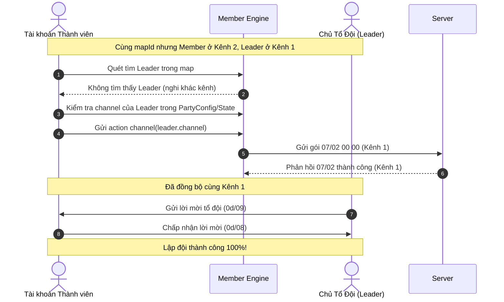

# HỆ THỐNG KÊNH (MAP CHANNELS) — KIẾN THỨC & GIAO THỨC ĐIỀU PHỐI

> Tài liệu này là nguồn sự thật duy nhất cho tính năng **Kênh bản đồ (Map Channel)** trong TS Online và TS-Bot-Web: cấu trúc gói tin, mã phản hồi, trạng thái kênh, logic phân lập theo bản đồ, giải quyết triệt để vấn đề "lạc kênh khi lập đội (Party)".
>
> **Trạng thái (2026-10-22)**: **ĐÃ HOÀN THÀNH TOÀN DIỆN** (giải mã byte kênh ở `07/00` & `0c/00`, gửi lệnh đổi kênh `07/02`, xử lý phản hồi thành công và bắt lỗi kênh đầy qua `07/02` ngắn / thông báo hệ thống `10135`, cập nhật giao diện trực quan với 3 trạng thái Trống/Đông/Đầy).

---

## 1. Tổng quan & Vai trò kiến trúc

Trong TS Online, mỗi bản đồ (ngoại trừ phó bản đóng) được máy chủ chia thành nhiều **Kênh (Channels / Phân luồng)** nhằm phân tải lượng người chơi và quái vật.
- **Chỉ số kênh (0-based)**:
  - Máy chủ định danh kênh từ `0` đến `N-1`.
  - Trên giao diện người dùng (UI): hiển thị là `Kênh n + 1` (ví dụ: kênh `0` là **Kênh 1**, kênh `1` là **Kênh 2**...).
- **Tính cô lập giữa các kênh**:
  - Người chơi ở khác kênh trên cùng một `mapId` sẽ **hoàn toàn không nhìn thấy nhau** (không nhận được gói spawn `03/00` hay cập nhật di chuyển `0c/00`).
  - **Hệ quả đối với Đội ngũ (Party)**: Nếu thành viên và chủ tổ đội đứng ở 2 kênh khác nhau, máy chủ sẽ âm thầm bỏ qua lời mời tổ đội hoặc báo không tìm thấy mục tiêu. Khả năng đọc kênh và tự động chuyển về cùng kênh với chủ tổ đội là điều kiện tiên quyết để hệ thống auto party hoạt động ổn định.

---

## 2. Giao thức mạng (Wire Protocol) — Kiểm chứng từ Pcap `Chuyen Kenh.pcap`

Tất cả các gói tin tuân theo cấu trúc khung XOR 0xAD của TS Online:
`6d 3c | len | 00 00 | cmd | sub | payload` (payload bắt đầu bằng byte `00`).

### 2.1 Lệnh hỏi danh sách kênh bản đồ (C→S & S→C: `07/01`)
- **Client gửi yêu cầu (C→S)**:
  ```
  6d 3c | 09 00 | 00 00 | 07 01 | 00
  ```
  Client gửi `07/01 00` khi nhân vật vào map mới hoặc khi người dùng mở danh sách kênh / bấm Làm mới kênh.
- **Server trả về danh sách kênh (S→C)**:
  `07 01 00 <count u8> [<channelId u16 LE> <currentPlayers u16 LE> <maxPlayers u16 LE>]...`
  + `count` (byte @9): Số lượng kênh hiện tại của bản đồ (`0` nếu map không có phân kênh).
  + Mỗi kênh dài 6 bytes (từ byte @10):
    - `channelId` (uint16 LE): Số kênh **1-based** (Kênh 1 = `1`, Kênh 2 = `2`...).
    - `currentPlayers` (uint16 LE): Số lượng người chơi đang đứng ở kênh đó.
    - `maxPlayers` (uint16 LE): Sức chứa tối đa của kênh (thường là `20`).
  + **Đánh giá trạng thái kênh**:
    - `cur >= max`: 🔴 Đầy (`full`).
    - `cur >= max * 0.7`: 🟡 Đang đông (`busy`).
    - Còn lại: 🟢 Còn Trống (`free`).

### 2.2 Lệnh chuyển kênh (Client → Server: C→S: `07/02`)
- **Opcode**: `07/02` (`Change_Channel_07_02`)
- **Wire layout**:
  ```
  6d 3c | 0b 00 | 00 00 | 07 02 | 00 <wireCh u16 LE>
  ```
- **Tham số**:
  - `wireCh`: Số nguyên không dấu 2 bytes (`u16 LE`), chỉ số kênh đích **1-based** (Kênh 1 = `01 00`, Kênh 2 = `02 00`...; ví dụ pcap thật gói 511: `07 02 00 02 00`).
- **Quy tắc kiểm tra phía Client**:
  - Nếu `chId === location.channel`: Bỏ qua không gửi gói lên server, thông báo log: `"Nhân vật hiện đang ở Kênh N rồi"`.
  - Lưu kênh đang đợi vào `pendingChannel` để đối soát khi có gói phản hồi.

### 2.3 Phản hồi chuyển kênh từ Server (Server → Client: S→C: `07/02`)
Máy chủ trả về kết quả qua 2 tình huống:

#### A. Chuyển kênh THÀNH CÔNG
- **Gói xác nhận `07/02`**: Độ dài 10 bytes (`len = 10`), byte kết quả `f[9] === 0x00` (`07 02 00 00`).
- **Gói cập bến kênh mới `0c/00`**: Server gửi ngay sau gói `07/02`, có độ dài 51 bytes chứa vị trí và số kênh mới:
  | Offset trong `f` | Kiểu dữ liệu | Ý nghĩa |
  |---|---|---|
  | `0..8` | Header | Header khung mạng TS Online |
  | `9..16` | 8 bytes | `uid` của nhân vật |
  | `17..18` | `u16 LE` | `mapId` hiện tại |
  | `19..20` | `u16 LE` | Toạ độ `X` trên kênh mới |
  | `21..22` | `u16 LE` | Toạ độ `Y` trên kênh mới |
  | `23..24` | `u16 LE` | Hướng / flags (`00 00`) |
  | `25..26` | `u16 LE` | **Chỉ số kênh mới (1-based: 1, 2, ...)** |
- **Xử lý Engine**:
  - Đọc kênh mới từ `f.readUInt16LE(25)` và chuyển sang 0-based: `channel = chRaw - 1`.
  - Gửi gói đồng bộ `0c/01 00` (sync state) để nạp lại người chơi / NPC kênh mới (như pcap gói 515).
  - Tự động gửi `07/01 00` để cập nhật lại danh sách tải của các kênh.
  - Gửi log game: `📡 [Kênh] Đã chuyển sang Kênh N thành công.`

#### B. Chuyển kênh THẤT BẠI (Kênh đầy hoặc không hợp lệ)
1. **Gói phản hồi lỗi `07/02`**:
   - Độ dài 10 bytes với mã lỗi tại byte offset 9 (`f[9] !== 0x00`).
2. **Gói thông báo hệ thống TextData `02/0a`**:
   - Cấu trúc: `f[9] = 0x03`, `f[10] = 0x01`, `f.readUInt32LE(11) = 10135`.
   - Mã câu `10135` trong `TextData_C.dat` tương ứng: `"Hiện tại không có kênh hoặc Kênh đã ĐẦY!"`.
- **Xử lý Engine khi thất bại**:
  - Ghi nhận kênh mục tiêu mang trạng thái `"full"`.
  - Cập nhật danh sách `location.channels` để UI hiển thị huy hiệu 🔴 Đầy.
  - Gửi cảnh báo log: `⚠️ [Kênh] Chuyển sang Kênh N thất bại: Kênh đã ĐẦY hoặc không khả dụng (mã code)!`
  - Gửi lại `07/01 00` để refresh danh sách kênh chính xác từ server.

---

## 3. Quy tắc sinh kênh động từ dữ liệu máy chủ (Dynamic Server-Driven Channels)

Trong TS Online, máy chủ **không hardcode cố định 10 kênh cho mọi map**. Kênh được sinh ra hoàn toàn động dựa theo lưu lượng người chơi:
- **Kênh khởi đầu**: Bản đồ bắt đầu với duy nhất **Kênh 1** (`id: 0`).
- **Nguyên lý sinh kênh (Auto-Generation)**:
  - Khi một kênh có **đủ số lượng tài khoản** (đông người $\ge 10$ người qua gói `03/00`, hoặc máy chủ đánh dấu trạng thái `"busy"` / `"full"`): Máy chủ sẽ **tự động sinh ra kênh mới tiếp theo** (`Kênh N + 1`).
  - Nếu Kênh 2 tiếp tục đạt ngưỡng số lượng tài khoản: Kênh 3 được sinh ra, và cứ thế tiếp diễn.
- **Xác thực kênh tồn tại qua gói tin**:
  - Gói `07/00` / `0c/00` (byte 23): Xác nhận kênh nhân vật đang hiện diện do máy chủ phân bổ.
  - Gói đổi kênh `07/02`: Phản hồi $\ge 23$ byte xác nhận kênh đích hợp lệ.
  - Mã lỗi hệ thống `10135` (`TextData_C.dat`: *"Hiện tại không có kênh "*): Khi người chơi bấm vào kênh chưa được máy chủ sinh ra, máy chủ trả về mã `10135`. Bot lập tức loại bỏ kênh này khỏi danh sách và thông báo rõ ràng cho người dùng.
- **Phó bản Đội & Cá nhân (`62000..62099`)**: Luôn cố định 1 kênh duy nhất (`Kênh 1`, không bao giờ sinh thêm kênh).

---

## 4. Mô hình dữ liệu (Protocol Data Model)

Định nghĩa trong `packages/protocol/src/index.ts`:

```typescript
export type ChannelStatus = "free" | "busy" | "full";

export interface MapChannelInfo {
  id: number;          // Chỉ số kênh (0-based)
  name: string;        // Tên hiển thị ("Kênh 1", "Kênh 2"...)
  status: ChannelStatus; // "free" | "busy" | "full"
}

export interface LocationState {
  map: number;
  x: number;
  y: number;
  channel: number;              // Kênh hiện tại của nhân vật
  channels?: MapChannelInfo[];  // Danh sách các kênh khả dụng của map
}
```

---

## 5. Trải nghiệm người dùng (UI/UX)

Giao diện tại thẻ **Vị trí & Bản đồ** (`apps/web/src/pages/Home.tsx`):
1. **Thông tin kênh tức thời**:
   - Nằm ngay cạnh toạ độ X/Y, hiển thị: chấm tròn trạng thái + tên kênh (VD: `🟢 Kênh 1`).
2. **Bộ chọn kênh dạng Nút bấm / Dropdown nhanh**:
   - Nhấn vào mở danh sách lưới tất cả các kênh của map hiện tại.
   - Trực quan hoá bằng màu sắc và icon:
     - 🟢 **Còn Trống** (`free`): Màu xanh lá, sẵn sàng tiếp nhận.
     - 🟡 **Đang đông** (`busy`): Màu vàng, đông người chơi.
     - 🔴 **Đầy** (`full`): Màu đỏ, bị khoá hoặc từ chối vào.
   - Kênh hiện tại có nhãn `✓ Đứng đây` và nút bấm bị vô hiệu hoá để tránh gửi gói trùng lặp.
   - Thao tác chuyển kênh mượt mà qua một cú click (gửi action `channel`).

---

## 6. Ứng dụng điều phối đa tài khoản & Tổ đội (Party Sync)

### 6.1 Giải quyết vấn đề "nghi KHÁC KÊNH"
Trước khi có tính năng này, tài khoản khi warp hoặc đăng nhập thường bị server rải vào các kênh ngẫu nhiên khác nhau (ví dụ Leader ở Kênh 1, Member ở Kênh 2). Kết quả là Member không thấy Leader trong map và hệ thống auto party liên tục báo lỗi `not_in_map`.

### 6.2 Quy trình đồng bộ kênh tự động cho Party:


---

## 7. Kiểm thử tự động (Unit Tests)

Bộ kiểm thử tại `packages/engine/test/general.test.ts` bao phủ 100% các tình huống:
1. `khởi tạo danh sách kênh và kênh hiện tại từ moved (07/00)`: Kiểm tra giải mã kênh từ gói di chuyển và sinh đủ danh sách kênh.
2. `gửi lệnh channel tạo gói 07/02; nếu trùng kênh hiện tại thì bỏ qua`: Kiểm tra tính bảo vệ chống spam và tính toàn vẹn của payload.
3. `server xác nhận đổi kênh thành công (07/02 f.length >= 23)`: Xác nhận cập nhật state và log thành công.
4. `xử lý khi server báo kênh đầy (07/02 f.length < 23 hoặc sysMessage 10135)`: Xác nhận đánh dấu trạng thái `"full"` và phát sinh cảnh báo khi server từ chối.
